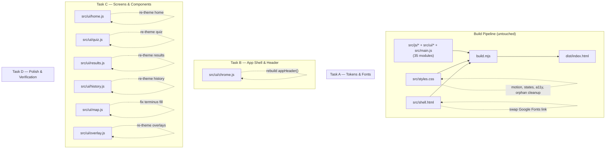

# Ceramic & Signal Line UI Rework — Implementation Plan

> **For agentic workers:** REQUIRED SUB-SKILL: Use superpowers:subagent-driven-development (recommended) or superpowers:executing-plans to implement this plan task-by-task. Steps use checkbox (`- [ ]`) syntax for tracking.

**Goal:** Rework every visual surface of Exam Lines to the *Ceramic & Signal Line Minimal* design system (DESIGN.md) while preserving 100% of business logic, state management, routing, theme storage, and keyboard shortcuts.

**Architecture:** The app is a single-page vanilla JS application bundled into one HTML file. CSS custom properties on `:root` control theming. The rework replaces token values, font stack, and component CSS — the JS render functions (`h()` / `svgEl()` calls) need only targeted class/attribute changes, not structural rewrites. No new JS files are added; `MODULE_ORDER.length` stays at 35.

**Architecture Diagram:**



**Tech Stack:** Vanilla JS (ES modules concatenated by `build.mjs`), CSS custom properties, SVG (transit map), Google Fonts, Node.js test runner (`node:test`).

**Spec:** [DESIGN.md](file:///e:/projects/exam-lines/DESIGN.md) — the Ceramic & Signal Line Minimal design system.

## Global Constraints

- `MODULE_ORDER.length === 35` — do not add or remove JS module files. Update `build.mjs` AND `test/build.test.js:45` together if ever needed.
- Single-file HTML output: no `<!DOCTYPE>`, exactly one `<script>`, `<link href>` only `fonts.googleapis.com` / `fonts.gstatic.com`.
- Forbidden JS APIs: `innerHTML`, `outerHTML =`, `insertAdjacentHTML`, `document.write`, `alert(`, `confirm(`, `prompt(`.
- Theme storage key `'pmle.theme.v1'` — do not rename or relocate.
- Theme attribute `data-theme` on `<html>` — do not change the mechanism.
- `.app` must NOT have `max-width: 1180px`. Must include `min-height: 100dvh;`.
- Must retain `:root[data-fullscreen="true"]`, `:fullscreen::backdrop`, `.quiz-stage`, `min-width: 900px`, `(max-width: 759px), (max-height: 620px)`, `id="fs-toggle"`, `padding: 0;`, `updateViaCache: 'none'`.
- No `2.8vw` side gutters, no `58vh` map height clamping.
- Zero hardcoded hex colors in component CSS — every color via `var(--token)`.
- All numeric displays: `font-variant-numeric: tabular-nums` and `Fragment Mono` where specified.
- Every change must render correctly in **both Light and Dark modes**.

## Review Focus

1. **Hardcoded `#FFFFFF` on colored backgrounds** — several hover/feedback states use `color: #FFFFFF` on muted line-color backgrounds. In Dark mode this fails WCAG (white on `--ok` green = 1.99:1). Ensure all instances use `var(--on-line)` or `var(--on-accent)` instead.
2. **`.tname`/`.tsub` SVG fill** — currently `fill: var(--paper)` which is invisible (1:1 contrast) outside `.terminus` rect. Must be `fill: var(--ink)`.
3. **Theme detection in `chrome.js:20`** — `isDark` only checks `data-theme === 'dark'`, missing OS dark mode with no explicit user preference. The sun/moon icon can show the wrong state on first load.
4. **Font family fallback chain** — if Google Fonts CDN is slow/blocked, `body` must fall back gracefully to `"Segoe UI", system-ui, -apple-system, sans-serif`, not to `Overpass` (which will no longer be loaded).
5. **CSS custom property completeness** — any CSS rule referencing a removed old token (`--l1` through `--l6` values change) or missing new token (`--accent`, `--on-accent`, `--on-line`) will produce `unset` and break rendering.

---

### Task A: Dual-Theme Semantic Tokens, Font Stack & Critical Bug Fixes

**Files:**
- Modify: [src/styles.css:1–67](file:///e:/projects/exam-lines/src/styles.css#L1-L67) (`:root` light tokens, `@media prefers-color-scheme` dark tokens, `[data-theme="dark"]` tokens)
- Modify: [src/styles.css:119–126](file:///e:/projects/exam-lines/src/styles.css#L119-L126) (`body` font-family declaration)
- Modify: [src/shell.html:5](file:///e:/projects/exam-lines/src/shell.html#L5) (Google Fonts `<link>`)
- Modify: [src/ui/chrome.js:20](file:///e:/projects/exam-lines/src/ui/chrome.js#L20) (`isDark` detection fix)
- Modify: [src/ui/map.js](file:///e:/projects/exam-lines/src/ui/map.js) (`.tname`/`.tsub` fill fix — find `fill: var(--paper)` or hardcoded `fill` on terminus text)
- Test: existing [test/build.test.js](file:///e:/projects/exam-lines/test/build.test.js) and [test/fullscreen-responsive.test.js](file:///e:/projects/exam-lines/test/fullscreen-responsive.test.js)

**Interfaces:**
- Consumes: `DESIGN.md` token tables (exact hex values for all CSS custom properties)
- Produces: New CSS custom property set (`--paper`, `--panel`, `--ink`, `--ink-2`, `--ink-3`, `--rule`, `--rule-2`, `--on-line`, `--accent`, `--on-accent`, `--focus`, `--ok`, `--bad`, `--flag`, `--l1`–`--l6`) available for all subsequent tasks. New font families loaded.

> [!IMPORTANT]
> This task introduces the new `--accent`, `--on-accent` tokens that don't currently exist. Every subsequent task depends on these being defined here first.

- [ ] **Step 1: Replace Light Mode `:root` token block**

  In [src/styles.css:1–21](file:///e:/projects/exam-lines/src/styles.css#L1-L21), replace the entire `:root { ... }` block with the Light Mode values from DESIGN.md, adding the new `--accent`, `--on-accent` tokens. Keep `color-scheme: light;` first.

  ```diff
  -  --paper: #F5F6F3;
  -  --panel: #FFFFFF;
  -  --ink: #1B1F24;
  -  --ink-2: #4A515A;
  -  --ink-3: #6E767F;
  -  --rule: #D5DAD4;
  -  --rule-2: #E7EAE5;
  -  --on-line: #FFFFFF;
  -  --l1: #D52B1E;
  +  --paper: #F5F4F0;
  +  --panel: #FCFCFA;
  +  --ink: #18181B;
  +  --ink-2: #3F3F46;
  +  --ink-3: #57575E;
  +  --rule: #DDDAD2;
  +  --rule-2: #ECEAE4;
  +  --on-line: #FFFFFF;
  +  --accent: #C83226;
  +  --on-accent: #FFFFFF;
  +  --l1: #C83226;
  ```

  (Continue for all tokens per DESIGN.md Light Mode table.)

- [ ] **Step 2: Replace Dark Mode token blocks**

  Replace both the `@media (prefers-color-scheme: dark) { :root:not([data-theme="light"]) { ... } }` block (lines 23–44) and the `:root[data-theme="dark"] { ... }` block (lines 47–67) with DESIGN.md Dark Mode values, including `--accent`, `--on-accent`, `--on-line` updates.

  ```diff
  -  --paper: #15181C;
  -  --panel: #1D2126;
  +  --paper: #141416;
  +  --panel: #1C1C1F;
  ```

  (Continue for all Dark Mode tokens per DESIGN.md.)

- [ ] **Step 3: Update `body` font-family**

  In [src/styles.css:120](file:///e:/projects/exam-lines/src/styles.css#L120):

  ```diff
  -  font-family: 'Overpass', "Segoe UI", system-ui, -apple-system, sans-serif;
  +  font-family: 'Onest', "Segoe UI", system-ui, -apple-system, sans-serif;
  ```

- [ ] **Step 4: Update Google Fonts `<link>` in shell.html**

  In [src/shell.html:5](file:///e:/projects/exam-lines/src/shell.html#L5):

  ```diff
  -<link rel="stylesheet" href="https://fonts.googleapis.com/css2?family=Overpass:wght@400;600;800&display=swap">
  +<link rel="stylesheet" href="https://fonts.googleapis.com/css2?family=Familjen+Grotesk:wght@600;700&family=Onest:wght@400;500;600;700&family=Fragment+Mono:wght@400&display=swap">
  ```

- [ ] **Step 5: Fix `isDark` detection in chrome.js**

  In [src/ui/chrome.js:20](file:///e:/projects/exam-lines/src/ui/chrome.js#L20), fix to also respect OS dark mode:

  ```diff
  -  const isDark = typeof document !== 'undefined' && document.documentElement.getAttribute('data-theme') === 'dark';
  +  const isDark = typeof document !== 'undefined' && (
  +    document.documentElement.getAttribute('data-theme') === 'dark' ||
  +    (document.documentElement.getAttribute('data-theme') !== 'light' && window.matchMedia('(prefers-color-scheme: dark)').matches)
  +  );
  ```

- [ ] **Step 6: Fix `.tname`/`.tsub` fill in map.js**

  In [src/ui/map.js](file:///e:/projects/exam-lines/src/ui/map.js), find every `svgEl('text', ...)` for `.tname` and `.tsub` that sets `fill: var(--paper)` or inherits an invisible fill, and change to `fill: var(--ink)`. Verify by searching the file for `tname` and `tsub`.

- [ ] **Step 7: Fix all hardcoded `#FFFFFF` on colored backgrounds in styles.css**

  Search `src/styles.css` for every `color: #FFFFFF` or `fill: #FFFFFF`. Replace with `color: var(--on-line)` or `color: var(--on-accent)` as appropriate. Key instances:
  - `.btn.stop:hover` (line ~236): `color: #FFFFFF` → `color: var(--on-accent)`
  - Any `.feedback` or `.opt.correct` rules using `#FFFFFF` on `--ok`/`--bad` backgrounds.

- [ ] **Step 8: Run tests to verify nothing broke**

  Run: `node --test test/build.test.js test/fullscreen-responsive.test.js`
  Expected: All tests PASS. Specifically verify:
  - `MODULE_ORDER.length === 35` ✓
  - Google Fonts link passes allowed-href check ✓
  - `:root[data-fullscreen="true"]`, `:fullscreen::backdrop`, `padding: 0;` all still present ✓

- [ ] **Step 9: Build and verify output**

  Run: `node build.mjs`
  Expected: `dist/index.html` and `dist/exam-lines.html` generated, under 16 MB.

- [ ] **Step 10: Commit**

  ```powershell
  git add src/styles.css src/shell.html src/ui/chrome.js src/ui/map.js DESIGN.md
  git commit -m "feat: ceramic & signal line tokens, font stack, bug fixes

  - Replace all CSS custom properties with Ceramic & Signal Line palette
  - Add --accent, --on-accent tokens for signal vermilion
  - Swap Overpass font stack for Familjen Grotesk + Onest + Fragment Mono
  - Fix isDark detection to respect OS prefers-color-scheme
  - Fix .tname/.tsub SVG fill from var(--paper) to var(--ink)
  - Replace hardcoded #FFFFFF on colored backgrounds with themed tokens"
  ```

---

### Task B: App Shell, Header & Navigation Redesign

**Files:**
- Modify: [src/ui/chrome.js:19–263](file:///e:/projects/exam-lines/src/ui/chrome.js#L19-L263) (themeSwitch, fullscreenSwitch, appHeader functions — restyle, not rewrite logic)
- Modify: [src/styles.css:239–430](file:///e:/projects/exam-lines/src/styles.css#L239-L430) (`.topbar`, `.brand-*`, `.net-switch`, `.btn-net`, `.theme-switch`, `.topnav`, `.chip`, `.status` styles)
- Modify: [src/styles.css:150–161](file:///e:/projects/exam-lines/src/styles.css#L150-L161) (`.app` container padding)
- Modify: [src/styles.css:187–237](file:///e:/projects/exam-lines/src/styles.css#L187-L237) (`.btn` family — border weight changes)
- Test: existing tests

**Interfaces:**
- Consumes: Task A's token set (`--paper`, `--panel`, `--ink`, `--rule`, `--accent`, etc.) and font families.
- Produces: Restyled `.topbar` (borderless strip), `.net-switch` (underline tabs), `.theme-switch` (text toggle), `.btn` (hairline borders). All subsequent tasks inherit these shell styles.

- [ ] **Step 1: Restyle `.topbar` to borderless strip**

  Replace `border-bottom: 2px solid var(--ink)` with `border-bottom: 1px solid var(--rule)`. Remove heavy visual weight.

  ```diff
  -  border-bottom: 2px solid var(--ink);
  +  border-bottom: 1px solid var(--rule);
  ```

- [ ] **Step 2: Restyle `.brand-title` to use Familjen Grotesk**

  ```diff
   .brand-title {
     font-size: 20px;
  -  font-weight: 800;
  +  font-weight: 700;
  +  font-family: 'Familjen Grotesk', sans-serif;
     letter-spacing: -0.5px;
   }
  ```

- [ ] **Step 3: Convert `.net-switch` from bordered pill to underline tabs**

  Replace the `.net-switch` and `.btn-net` CSS with underline tab styling:
  - Remove `border: 2px solid var(--ink)`, `border-radius: 6px`, `overflow: hidden`, `background: var(--panel)` from `.net-switch`.
  - Set `.net-switch` to `display: inline-flex; gap: 0;`.
  - `.btn-net`: `padding: 4px 12px; border: none; border-bottom: 2px solid transparent; background: transparent; cursor: pointer; color: var(--ink-3); transition: color 180ms ease, border-color 180ms ease;`.
  - `.btn-net.active`: `color: var(--ink); border-bottom-color: var(--ink); font-weight: 700;` — remove `background: var(--ink); color: var(--paper);`.
  - `.btn-net:hover:not(.active)`: `color: var(--ink-2);`.
  - Remove `.btn-net:first-child { border-right: ... }`.

- [ ] **Step 4: Convert `.theme-switch` to minimal mono text toggle**

  Replace `.theme-switch` CSS: remove border/radius/padding/track/knob styles. New:
  - `.theme-switch`: `display: inline-flex; align-items: center; gap: 6px; border: none; background: transparent; cursor: pointer; padding: 4px 0; font-family: 'Fragment Mono', monospace; font-size: 12px; letter-spacing: 0.3px; color: var(--ink-3);`.
  - Remove `.theme-switch .track`, `.theme-switch .knob` CSS rules entirely.

  In [src/ui/chrome.js:19–50](file:///e:/projects/exam-lines/src/ui/chrome.js#L19-L50), update `themeSwitch()` to render as a text label + icon instead of track/knob. Keep the toggle `onclick: () => actions.toggleTheme()` logic untouched. Change returned DOM to:
  - `h('button', { class: 'theme-switch', ... }, icon, h('span', {}, isDark ? 'Dark' : 'Light'))`.

- [ ] **Step 5: Restyle all `.btn` borders from 2px to 1px hairlines**

  In `.btn` (line ~187):
  ```diff
  -  border: 2px solid var(--ink);
  +  border: 1px solid var(--rule);
  ```

  In `.btn.go` (primary filled button): keep `border: none` (it's filled with `--ink`).

  In `.btn.stop`: `border: 1px solid var(--bad)`.

  Update `.net-switch` border too (already handled in Step 3).

  Update `.chip` border: already `1px solid var(--rule)` — no change needed.

- [ ] **Step 6: Add heading font-family to section headings**

  Add to styles.css a rule for `.masthead h1`, `.masthead h2`, or equivalent heading selectors:
  ```css
  .masthead h1, .page-home h2, h1, h2 {
    font-family: 'Familjen Grotesk', sans-serif;
  }
  ```
  (Verify actual heading selectors used in `home.js`, `results.js`, `history.js`.)

- [ ] **Step 7: Add Fragment Mono to numeric elements**

  Add CSS rules:
  ```css
  .val, .timer, .score, .pct, .num, .mono {
    font-family: 'Fragment Mono', monospace;
  }
  ```
  (Audit all `.val`, timer, score elements across `chrome.js`, `quiz.js`, `results.js`, `history.js` to ensure they use one of these classes.)

- [ ] **Step 8: Run tests**

  Run: `node --test test/build.test.js test/fullscreen-responsive.test.js`
  Expected: All PASS. Verify `id="fs-toggle"` still present, `.topbar` sticky behavior preserved for desktop, static for mobile breakpoints.

- [ ] **Step 9: Build and verify**

  Run: `node build.mjs`
  Expected: Clean build.

- [ ] **Step 10: Commit**

  ```powershell
  git add src/styles.css src/ui/chrome.js
  git commit -m "feat: ceramic header — borderless strip, underline tabs, mono theme toggle

  - Topbar: 1px hairline bottom instead of 2px solid ink
  - Net-switch: plain underline tabs instead of bordered pill
  - Theme toggle: minimal Fragment Mono text label with icon
  - All .btn borders: 1px hairline var(--rule) instead of 2px solid ink
  - Brand title: Familjen Grotesk 700
  - Headings: Familjen Grotesk
  - Numeric values: Fragment Mono"
  ```

---

### Task C: Screens & Components Re-theming

**Files:**
- Modify: [src/styles.css:430–1684](file:///e:/projects/exam-lines/src/styles.css#L430-L1684) (all component styles: `.page-home`, `.masthead`, `.map-section`, `.sysmap`, `.tickets`, `.ticket`, `.stub`, `.panel`, `.quiz-stage`, `.route`, `.stops-list`, `.stop-item`, `.opt`, `.feedback`, `.quiz-toolbar`, `.arrival`, `.bars`, `.review-item`, `.overlay`, `.overlay-card`, `.page-history`)
- Modify: [src/ui/home.js](file:///e:/projects/exam-lines/src/ui/home.js) (minor class/attribute adjustments if needed)
- Modify: [src/ui/quiz.js](file:///e:/projects/exam-lines/src/ui/quiz.js) (minor class/attribute adjustments if needed)
- Modify: [src/ui/results.js](file:///e:/projects/exam-lines/src/ui/results.js) (minor class/attribute adjustments if needed)
- Modify: [src/ui/history.js](file:///e:/projects/exam-lines/src/ui/history.js) (minor class/attribute adjustments if needed)
- Modify: [src/ui/overlay.js](file:///e:/projects/exam-lines/src/ui/overlay.js) (overlay panel styling)
- Test: existing tests

**Interfaces:**
- Consumes: Task A's tokens, Task B's header/button/font styles.
- Produces: Fully re-themed screens — every visible surface matches DESIGN.md in both Light and Dark mode.

- [ ] **Step 1: Re-theme Home page (`.page-home`, `.masthead`, `.map-section`, `.tickets`, `.ticket`, `.stub`)**

  - `.masthead`: Ensure heading uses Familjen Grotesk, adequate spacing (`margin-bottom: 24px`).
  - `.map-section`: Full-bleed — remove any side padding that clips the SVG panorama. Background: `var(--paper)`.
  - `.tickets` / `.ticket`: Replace heavy borders with `1px solid var(--rule)` or borderless with tonal `--panel` background.
  - `.stub`: Hairline separators instead of full border boxes.
  - Remove any `border: 2px solid` instances. Replace with `1px var(--rule)` hairlines.

- [ ] **Step 2: Re-theme Quiz page (`.quiz-stage`, `.route`, `.stops-list`, `.stop-item`, `.opt`, `.feedback`, `.quiz-toolbar`)**

  - `.opt` (answer options): Hairline `border-bottom: 1px solid var(--rule-2)` between items instead of heavy bordered cards. Selected state: `background: var(--rule-2); font-weight: 600`.
  - `.feedback`: Correct uses `border-left: 3px solid var(--ok)`, wrong uses `border-left: 3px solid var(--bad)`. Background stays transparent or very subtle tonal. Text color uses themed tokens, never hardcoded `#FFFFFF`.
  - `.quiz-toolbar`: Sticky bottom bar with `1px solid var(--rule)` top border instead of heavy border. Background `var(--panel)`.
  - Remove any `2px solid var(--ink)` borders from quiz components.
  - Ensure timer and question counter use `Fragment Mono`.

- [ ] **Step 3: Re-theme Results page (`.arrival`, `.bars`, `.review-item`)**

  - `.arrival` banner: Clean surface with `var(--panel)` background, `8px` radius, no heavy border. Pass/fail indicator uses `--ok`/`--bad` accent, not hardcoded color.
  - `.bars`: Track `6px` height with `var(--rule-2)` background, fill uses `var(--line)`, `3px` radius. Number labels in `Fragment Mono`.
  - `.review-item`: Hairline `1px solid var(--rule-2)` bottom border between items. Correct/wrong indicators via subtle `border-left: 3px solid var(--ok/--bad)`.

- [ ] **Step 4: Re-theme History page (chart + table)**

  - History table rows: Hairline `1px solid var(--rule-2)` between rows. Header row: `font-weight: 600; border-bottom: 1px solid var(--rule)`.
  - Score and percentage cells: `Fragment Mono`.
  - Chart: ensure line colors use `var(--l1)`–`var(--l6)` tokens (they should already via JS; verify no hardcoded hex in chart rendering).

- [ ] **Step 5: Re-theme Overlays (`.overlay`, `.overlay-card`)**

  - Backdrop: `background: rgba(0,0,0,0.45)` (Light) — verify the overlay CSS sets this using a themed approach. Dark mode can use `rgba(0,0,0,0.6)`.
  - `.overlay-card`: `background: var(--panel); border: 1px solid var(--rule); border-radius: 12px; padding: 24px 28px; max-width: 480px;`.
  - Shadow: `box-shadow: 0 8px 32px rgba(0,0,0,0.12)`.
  - Remove any `border: 2px solid var(--ink)` from overlay cards.

- [ ] **Step 6: Audit for remaining hardcoded colors**

  Search entire `src/styles.css` for any hex color (`#[0-9A-Fa-f]`) outside the `:root` / `[data-theme]` blocks. Replace each with the appropriate CSS variable. Also search all `.js` files in `src/ui/` for inline `style` attributes containing hardcoded hex — replace with CSS variable references or classes.

- [ ] **Step 7: Run tests**

  Run: `node --test test/build.test.js test/fullscreen-responsive.test.js`
  Expected: All PASS.

- [ ] **Step 8: Build and verify**

  Run: `node build.mjs`
  Expected: Clean build.

- [ ] **Step 9: Commit**

  ```powershell
  git add src/styles.css src/ui/home.js src/ui/quiz.js src/ui/results.js src/ui/history.js src/ui/overlay.js
  git commit -m "feat: ceramic re-theme — all screens and components

  - Home: borderless tickets, full-bleed map section
  - Quiz: hairline option separators, themed feedback indicators
  - Results: tonal arrival banner, slim progress bars
  - History: hairline table rows, mono numeric cells
  - Overlays: rounded panel, subtle shadow, themed backdrop
  - Zero hardcoded hex outside :root token blocks"
  ```

---

### Task D: States, Motion, Accessibility & Polish

**Files:**
- Modify: [src/styles.css](file:///e:/projects/exam-lines/src/styles.css) (add motion transitions, clean orphaned classes, add `:focus-visible` ring using `--focus`, scrollbar theming)
- Modify: [src/ui/overlay.js](file:///e:/projects/exam-lines/src/ui/overlay.js) (verify focus trap on overlay open)
- Modify: [src/ui/map.js](file:///e:/projects/exam-lines/src/ui/map.js) (add track-focus dimming interaction)
- Test: existing tests + manual browser verification

**Interfaces:**
- Consumes: All previous tasks' outputs — fully re-themed app.
- Produces: Production-ready UI with motion, a11y, states, and cleaned-up CSS.

- [ ] **Step 1: Add track-focus dimming to transit map**

  In [src/ui/map.js](file:///e:/projects/exam-lines/src/ui/map.js), add hover event listeners on each track group (`.l1`–`.l6` containers). On hover: set all other track groups to `opacity: 0.32`. On mouse-leave: restore to `opacity: 1`. Use `220ms ease-out` for dim, `180ms ease-in` for restore.

  In CSS, add transition rule:
  ```css
  .sysmap .track-group {
    transition: opacity 220ms ease-out;
  }
  ```
  (Verify the actual SVG group class/selector used in `map.js` for each line's path+stops group.)

- [ ] **Step 2: Add motion transitions per DESIGN.md Motion table**

  Add to `src/styles.css`:
  ```css
  .btn {
    transition: background-color 150ms ease, border-color 150ms ease, transform 80ms ease;
  }
  .btn:active:not(:disabled) {
    transform: translateY(1px);
  }
  .overlay {
    transition: opacity 200ms ease-out;
  }
  .overlay-card {
    transition: opacity 200ms ease-out, transform 200ms ease-out;
  }
  ```
  (Merge with any existing `transition` declarations — don't duplicate.)

- [ ] **Step 3: Update `:focus-visible` ring to use `--focus` (vermilion/matte-vermilion)**

  In [src/styles.css:168–178](file:///e:/projects/exam-lines/src/styles.css#L168-L178), verify `:focus-visible` already uses `var(--focus)`. If so, it now inherits the new vermilion `--focus` value from Task A. No CSS change needed — just verify. Also verify the fullscreen `:focus-visible` override at lines 173–178.

- [ ] **Step 4: Theme scrollbars**

  Add thin scrollbar styling:
  ```css
  * {
    scrollbar-width: thin;
    scrollbar-color: var(--rule) transparent;
  }
  ::-webkit-scrollbar { width: 6px; height: 6px; }
  ::-webkit-scrollbar-thumb { background: var(--rule); border-radius: 3px; }
  ::-webkit-scrollbar-track { background: transparent; }
  ```

- [ ] **Step 5: Clean orphaned CSS classes**

  Audit and remove or re-attach the 11 orphaned CSS classes identified in Phase 1 critique. For each: search `src/ui/*.js` and `src/main.js` for usage. If no JS file creates an element with that class, remove the CSS rule. Document which were removed.

- [ ] **Step 6: Verify empty/loading/error states render correctly**

  Manually confirm that:
  - `.boot` loading message ("Loading the network map…") is visible in both themes.
  - History page with no sessions shows appropriate empty state.
  - Quiz with no questions loaded shows appropriate state.
  - Any `error` or `no-results` states in the app render with themed colors.

  If any state is missing or unstyled, add minimal styling using existing tokens (not new components).

- [ ] **Step 7: Verify responsive behavior at key breakpoints**

  Run `node build.mjs` to get latest build. Check (via browser subagent or manual):
  - Desktop `1440×900`: sticky header, full layout, theme toggle works.
  - Mobile `375×812`: static header, single-column, no horizontal overflow.
  - TV `1920×1080`: edge-to-edge map, no letterboxing, fullscreen toggle works.
  - Both Light and Dark mode at each viewport.

- [ ] **Step 8: Run final test suite**

  Run: `node --test test/build.test.js test/fullscreen-responsive.test.js`
  Expected: All PASS. This is the final gate.

- [ ] **Step 9: Final build**

  Run: `node build.mjs`
  Expected: Clean build producing `dist/index.html` and `dist/exam-lines.html`.

- [ ] **Step 10: Commit**

  ```powershell
  git add src/styles.css src/ui/map.js src/ui/overlay.js
  git commit -m "feat: ceramic polish — motion, a11y, track dimming, scrollbars, cleanup

  - Track-focus dimming: hover highlights single line, dims others to 0.32
  - Button active: translateY(1px) tactile press
  - Overlay: fade-in/scale entrance animation
  - Focus-visible: vermilion ring in both themes
  - Themed scrollbars
  - Removed N orphaned CSS classes
  - Verified empty/loading/error states in both themes"
  ```
